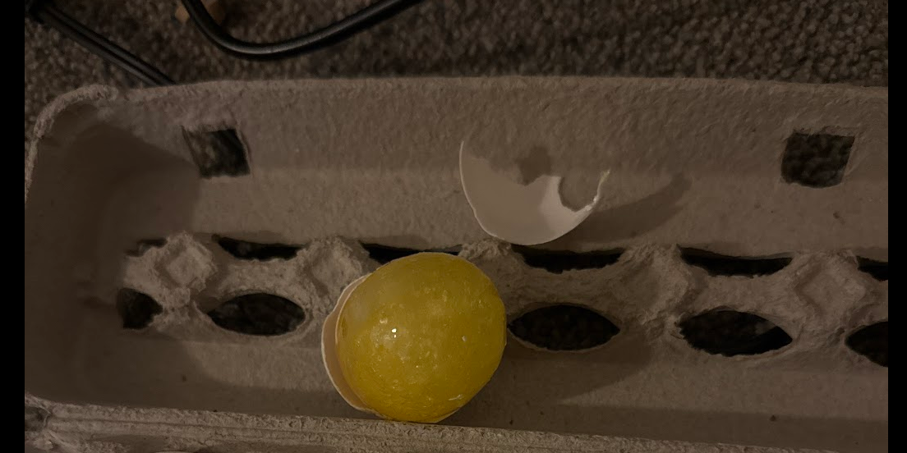

---
# ---- required ----
title: "DEFCON CTF Finals"                     
description: "The start of the end"
date: 2026-10-14        # change later                       
authors:
  - toasty                                      

# ---- optional (uncomment to use) ----
tags:
  - defcon!
image: ./assets/banner.jpg                    
draft: false                                                              
---

This summer, I had the pleasure to play the Distinguished Enthusiasts' Flocking Convention for Ornithology and Naturalism Championship of Top Finders Finals (DEFCON CTF Finals) held by the Benevolent Bureau of Birds (BBB) with SuperDiceCodeLovers (SDCL).

> we live in a world of acronyms

This was actually my 2nd time coming to DEFCON, with the first mostly just gooning around going to random villages. I did win NoobCTF at that time with [Geo](https://discord.com/users/757277675286167603) and [Uvuvue](https://discord.com/users/365980608264142851) so that was fun I guess. 

SPL did play DEFCON with SuperDiceCode *(notice no Lovers?)* but most of our team were also enjoying the conference itself, and it was mostly our team captains' Dudcom and Brayden plus a few others supporting SDC, which then ultimately allowed us to compete with them. Shoutout to my goats.

Here's a golden egg to break the text:

## Pre ~~game~~ comp
